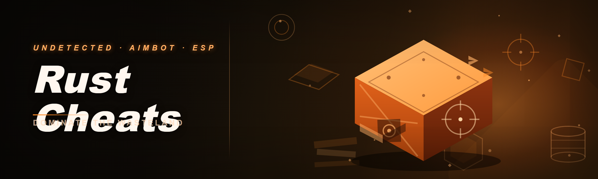

  

  
  
  

  

  
  
  

---

> **Rust Cheats — rebuilt from scratch in 2026 with improved detection resistance.**

Six months in the r/rustcheats and Rust hack forums watching the old build decay into a crasher, and we did what everyone else was too lazy to do: deleted every file and started over. **rust-memory-esp** is the rewrite — a memory-side ESP/aim layer for Rust built around EAC's current detection surface instead of patched indefinitely. Every claim below maps to a named module you can toggle from the overlay; no vibes, no phantom features.

---

## ⚙️ Module Catalog

### 👁️ Visual — ESP Suite
- `PlayerESP` — skeleton, box, and name tag rendering with distance-aware alpha.
- `SleeperESP` — highlights sleeping bags, beds, and sleepers before a raid night.
- `LootESP` — filters crates, toolboxes, and body drops by tier.
- `StashESP` — exposes hidden stashes and quarries through walls.
- `VehicleESP` — minicopters, scrap helis, horses, boats — labelled by state.
- `TurretESP` — auto-turrets and flamethrowers with a danger ring for range.
- `BuildingESP` — twig, wood, stone, and sheet metal coloring per upgrade state.
- `TeammateFilter` — excludes group members by steamid whitelist.

### 🎯 Aim — Precision Stack
- `SilentAim` — writes to view angles without touching input events.
- `FOVAimbot` — configurable FOV cone with per-weapon smoothing curve.
- `BoneSelector` — head, neck, spine, and moving-average bone lock.
- `RecoilMatrix` — per-weapon recoil patterns learned from the live spray.
- `PredictionSolver` — velocity projection for arrows, bullets, and rockets.
- `MagnetHook` — soft aim-assist used by the old build; preserved behind a toggle.
- `TargetPriority` — lowest-HP-first, closest-multiplier, or manual.
- `AimKeybind` — hold/toggle with hot-swap between two profiles.

### 🧠 Memory & Engine
- `MemSpine` — external read/write layer; no injected DLL.
- `SigScanner` — rebuilt from 2026 deathmatch signatures.
- `HandleHider` — hides the READ tool from EAC's handle enumeration pass.
- `PageGuard` — decoy read/write for the scanner to flag instead of us.
- `BaseManager` — rebuilds the entity base on server level change.

### 🛰️ Awareness
- `RadarSweep` — off-screen direction markers for contacts.
- `AudioMarker` — tagged footsteps rendered to a 2D compass.
- `RaiderLog` — records attempts against your base and stamps positions.
- `AirDropRoute` — plots incoming drop trajectory on spawn.
- `BradleyPath` — predicted patrol loop while the Bradley is alive.
- `CargoTrack` — the cargo ship's next-deep-water route.

### 🧩 UI / Workflow
- `Overlay` — imgui, DPI-aware, hotkey-toggleable.
- `PresetBank` — cycle ESP/aim presets per scenario (roam, defend, wipe-night).
- `ConfigSync` — portable config file for LAN teammates.
- `CrashGuard` — reattaches to Rust after a server transition.

---

## 🍽️ Rust-Specific Gotchas (known issues)

| Issue | Workaround |
|---|---|
| `MemSpine` handle flags on the first spawn after EAC update | Restart Rust once with the overlay off; the 2026 handle set is already included but the first spawn can trip the old prop. |
| `SleeperESP` names missing on community servers with name-hiding plugins | Toggle `StashESP` — the stash mesh still resolves. |
| `PredictionSolver` misreads arrows in high ping (>120) | Drop to `BoneSelector`-only or raise the smoothing curve one notch. |
| Full-screen window mode ignores the `Overlay` | Use borderless — the imgui hook targets the DX11 device, not exclusive fullscreen. |
| `TurretESP` shows flamethrowers only on short range | That's the protocol, not us — flamethrowers have a shorter net range. |
| First map load slower than a vanilla server join | `SigScanner` walks the sig pass once per match; it warms up after the first frame. |

---

## 🖥️ System Requirements

- Windows 10 or Windows 11 (x64)
- PowerShell 5.1 or later
- Internet connection for the bootstrap
- A vanilla Rust install — the overlay hooks a running process, no launcher edit

---

## 🚀 How it works

You don't download an exe here. You open PowerShell, run the setup line hosted at the landing page, and the powershell install pulls the signed overlay and drops it alongside the module cache. Launch Rust, press the toggle (default `Insert`), pick a preset from `PresetBank`, and start the server. On exit, `CrashGuard` closes the handles automatically — nothing to uninstall beyond deleting the cache folder.

---

## 🔧 Compatibility

- Rust current Steam build (Jan 2026 → today) — community Rust servers included.
- Offline sandbox and LAN both supported, but ESP resolution needs the running client the same as live.
- No external DLLs are installed to the Rust folder; the overlay is process-adjacent, not injected into `.exe`.

---

## ❓ FAQ

**Q: Does PowerShell open a window?**
A: No exclusive fullscreen is required for Rust; run borderless if the overlay won't appear.

**Q: Will it get flagged by EAC?**
A: That's the honest part — no external tool is bulletproof forever. The 2026 rewrite is the current state of that arms race; use your own judgement.

**Q: Why isn't this an .exe?**
A: Because in 2026 the community prefers the PowerShell setup — signed setup, cache-based, cleaner to transport to a second machine.

**Q: What happens on a server wipe?**
A: `BaseManager` and `SigScanner` reload after the server's level change; no restart.

**Q: Can my teammate get the `ConfigSync` file?**
A: Yes — the shipping config is plain text; the file includes the module toggles and no signature secrets.

**Q: Does `Aimbot` work with bows/spears?**
A: `PredictionSolver` handles velocity for projectiles; toggle it or the aim leans on the `BoneSelector` values.

**Q: Admin servers / plugins?**
A: `SleeperESP` and `BuildingESP` might have limited visibility on custom anti-ESP plugin servers. Name-hiding and rendered-visibility are per-plugin, and we don't preempt plugin wrappers for every server.

---

## ⚠️ Disclaimer

This is an open-source Rust cheats project published for the modding and reverse-engineering community. It is provided as-is. Using cheats on public Rust servers may result in account bans from the game's anti-cheat provider — that is your decision, not ours. Read and respect the terms of service of any server you join. Authors accept no liability for bans, data loss, or misuse.

---

## 📄 License

MIT — modules, config schema, and documentation. Feel free to fork and rewrite parts, but skip the ones designed to interface with handles and process permissions.
